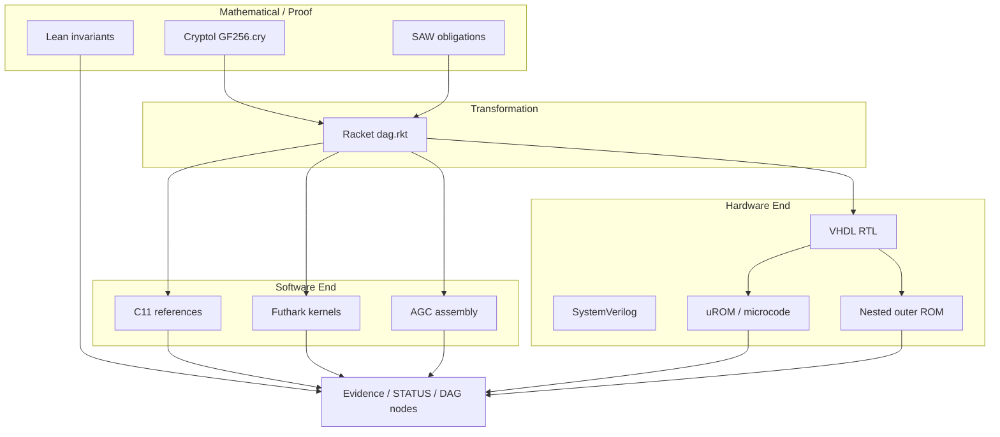
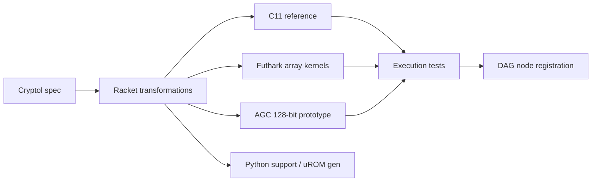
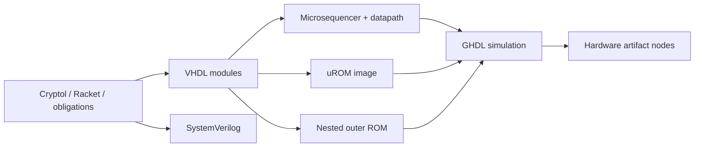
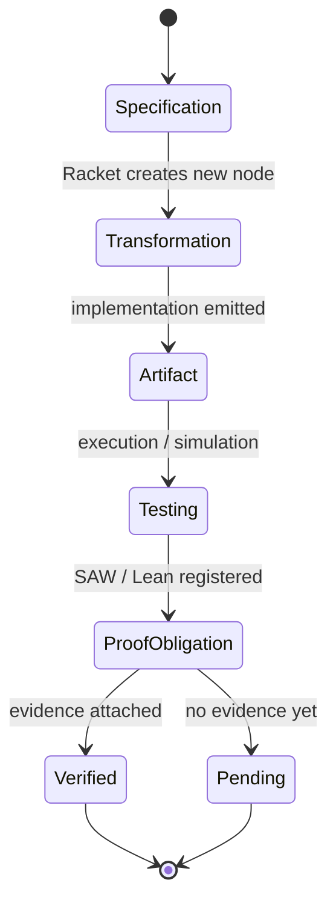
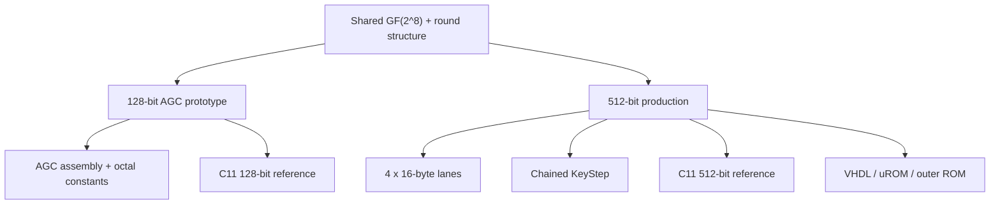
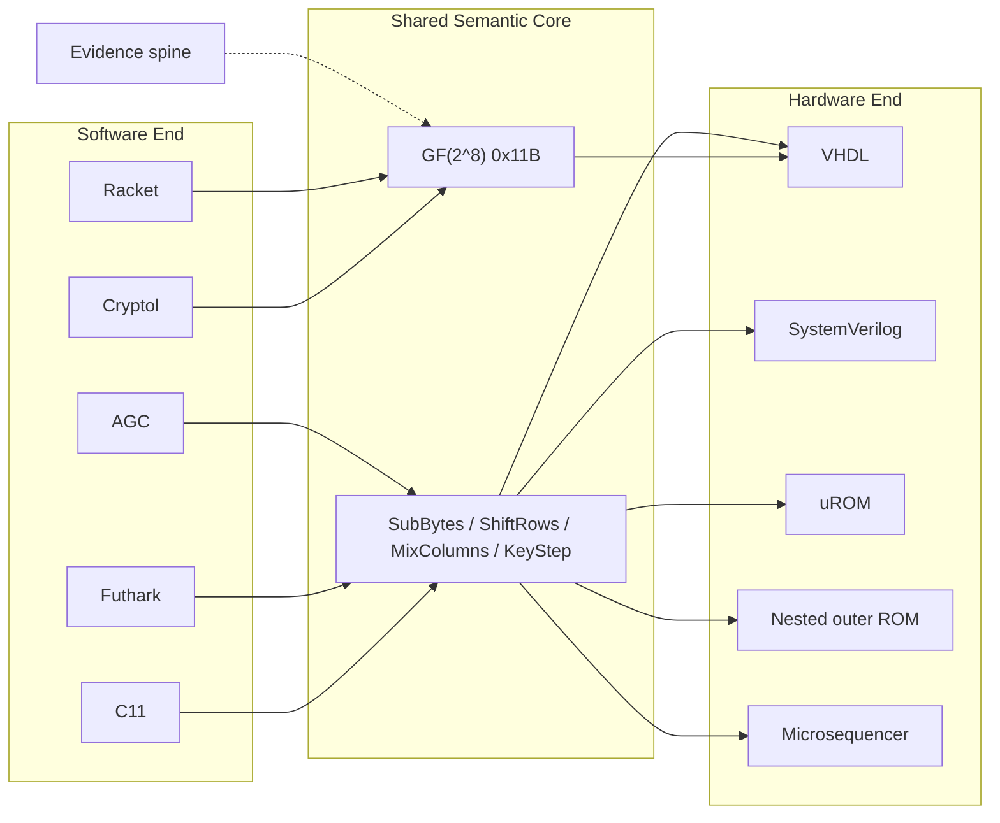

# NovaDag: A RIJNDAEL-uROM Verified Transformation DAG

### Illustrative Visual Concept

A single large hero architecture poster in a blueprint / engineering manuscript aesthetic. Dark navy background with hairline white and cyan geometry, soft gold accents for verification spines, and restrained ochre for hardware ROM imagery. No marketing gloss; think technical drawing mixed with circuit schematic and directed graph.

**Layout and hierarchy**  
- Central hub: a circular DAG core labeled “NovaDag / rijndael.dag.v1” with the rule in small type: “A transformation creates a new node. It never silently rewrites its source.”  
- Concentric rings or a left-to-right branching graph radiating from the hub.  
- Left half: software end (Cryptol, SAW obligations, Racket, C11, Futhark, AGC).  
- Right half: hardware end (VHDL, SystemVerilog, microcode ROM, nested outer ROM, microsequencer, datapath).  
- Vertical proof/verification spine running through the middle, connecting shared semantics (GF(2⁸), round structure) to evidence nodes.  
- Node shapes carry type labels: math spec, proof obligation, software artifact, hardware artifact, ROM image, test evidence, lineage metadata.  
- Arrows are labeled with transformation names or “pending SAW” / “execution-verified”.  
- Small mathematical cues on the left: GF(2⁸) polynomial 0x11B, xtime, lane permutation [0,5,10,15,…].  
- AGC cues: octal constants, Block-II word width.  
- Hardware side: microcode ROM tiles, nested outer ROM with SHA-256 digest words, fail-stop path.  
- Clear visual hierarchy: thicker lines for verified-by-execution paths, dashed for registered-but-not-discharged obligations.  

Viewer reads from the central rule outward, then left-to-right across the software/hardware boundary, with the verification spine as the binding element.

---

### Mermaid Diagrams

**Diagram 1 — Top-level system DAG**

*Major layers from mathematical specification through orchestration to software and hardware artifacts, with evidence collected at the leaves. Cryptol and SAW remain proposed/registered in the current tree.*

**Diagram 2 — Software pipeline**

*Software path: Cryptol meaning is lowered through Racket into inspectable C, Futhark, and AGC forms; tests feed evidence into the DAG.*

**Diagram 3 — Hardware pipeline**

*Hardware path from shared semantics to RTL, microcode ROM, and nested outer ROM; simulation provides the current verification evidence.*

**Diagram 4 — Proof-carrying node lifecycle**

*A node may exist in any state; verified equivalence requires attached evidence. Silent rewrite of a source is forbidden.*

**Diagram 5 — 128-bit and 512-bit cipher branches**

*Two specifications share algebra; the 128-bit branch targets AGC, the 512-bit branch targets production hardware and the nested ROM.*

**Diagram 6 — Hardware vs software boundary**

*Shared mathematical core in the middle; software and hardware ends meet through verified transformations and execution evidence.*

---

### Manuscript

#### 1. Title
NovaDag: RIJNDAEL-uROM Verified Transformation DAG

#### 2. Abstract
NovaDag is a versioned, proof-carrying transformation graph that carries a custom Rijndael-style cipher from mathematical specification to software and hardware artifacts. Every transformation creates a new node; source nodes are never silently rewritten. The graph holds two cipher specifications (a 128-bit AGC prototype and a 512-bit production form), hand-written kernels, RTL, microcode ROM images, and attached evidence. Verification currently rests on execution and simulation results recorded in STATUS.md; formal Cryptol/SAW discharge and full Lean typechecking remain registered or partial.

#### 3. Introduction
Conventional cipher implementations scatter specifications, reference code, RTL, and test vectors across files with weak lineage. NovaDag treats the collection as a directed acyclic graph under schema `rijndael.dag.v1`. A node records its parents, language, cryptographic parameters, transformation engine, and verification status. The critical invariant is that a transformation produces a successor node rather than mutating its source. This yields inspectable, reproducible lineage from GF(2⁸) arithmetic through C, Futhark, AGC, VHDL, and nested ROM artifacts.

#### 4. System Overview
The repository is organized by layer:

- `cryptol/` — mathematical meaning  
- `saw/` — registered proof obligations  
- `racket/` — DAG engine and provenance  
- `c11/` — CompCert-friendly reference implementations  
- `futhark/` — array kernels  
- `agc/` — 128-bit Apollo assembly  
- `vhdl/` — RTL (ALU, microsequencer, uROM, nested outer ROM)  
- `microcode/` — uROM assembler, ISA, generated images  
- `proofs/` — Lean invariants  
- `dag/` — node records  
- `verification/` — test vectors and outputs  

Language distribution is dominated by VHDL, C, Lean, SystemVerilog, and assembly, reflecting the cross-layer character of the stack.

#### 5. The Cipher Specifications
Two custom ciphers are carried.

**128-bit prototype.** An AES-like 10-round structure with a 0xA5 tweak in the key schedule. Implemented toward the Apollo Guidance Computer with hand-crafted octal constants and AGC-specific mapping. Output differs from standard AES-128 precisely because of the tweak.

**512-bit production specification.** 64-byte state organized as four lanes of 16 bytes. Ten rounds of SubBytes, ShiftRows (lane permutation [0,5,10,15, 4,9,14,3, 8,13,2,7, 12,1,6,11]), MixColumns (standard 4×4 GF(2⁸) matrix), and a chained KeyStep (byte 0 = key[0] ⊕ SBOX(key[63]) ⊕ (RCON[round] ⊕ 0xA5); subsequent bytes are successive XORs). This is not AES-128 or AES-256.

#### 6. DAG Semantics
Nodes follow schema `rijndael.dag.v1`. Example node `agc.gf256.mul.v2` records field parameters, parents, source file, transformation name, and pending obligations. The Racket engine (`racket/dag.rkt`) enforces unique identifiers, parent existence, and acyclicity. A node may exist before proof completion; it cannot claim verified equivalence without evidence. Current evidence is primarily execution and simulation results catalogued in STATUS.md.

#### 7. Transformation Layers
Cryptol defines primitive meaning (`cryptol/GF256.cry` supplies xtime and gfMul with identity and commutativity properties). SAW obligations register the required evidence for each lowering (symbolic equivalence for C11, array equivalence for Futhark, instruction-semantic refinement for AGC, RTL equivalence for VHDL, etc.). Racket performs the actual node creation and metadata attachment. Lean files hold formal invariants; their concrete numeric claims have been cross-checked by execution, but the Lean files themselves are not typechecked in the present environment.

#### 8. Custom Hand-Written Kernels
Hand-written kernels are central. They appear as:

- Low-level GF(2⁸) arithmetic in C11, Futhark, AGC, and VHDL ALU  
- Custom cipher rounds and key schedule  
- AGC-targeted routines with explicit octal constants and loop bounds  
- Hardware kernels in VHDL and SystemVerilog  
- Array kernels in Futhark  

Hand-writing preserves explicit semantics, inspectability, architectural control, and deterministic lineage. These properties make the kernels suitable for both differential testing and future refinement proofs. Several AGC routines remain stubs; the S-box rope holds only a partial table.

#### 9. Software-End Artifacts
- Cryptol specification (proposed; not typechecked here)  
- SAW obligations (registered, not discharged)  
- Racket DAG engine (in-memory checks pass)  
- C11 references (compile and run; 128-bit and 512-bit ciphertexts recorded; GF(2⁸) exhaustive match)  
- Futhark kernels (agree with C on 65 536 GF multiplications and on S-box / ShiftRows)  
- AGC assembly (128-bit prototype; loop-bound equivalence verified for gf_mul)  
- Python support (uROM generator reproduces shipped images byte-identically)  

SUBLEQ/OISC lowering is documented as an external path, not part of the core DAG.

#### 10. Hardware-End Artifacts
- VHDL modules: GF(2⁸) ALU, bootloader, microsequencer, uROM, nested outer ROM controller  
- SystemVerilog counterpart (verified by inspection against C)  
- Microcode ROM images and assembler  
- Datapath, state and key registers, microsequencer  
- Nested outer ROM that embeds the SHA-256 digest of the (external) DAG manifest, locks the inner machine, and fail-stops on mismatch  

GHDL simulation confirms hardware/software cross-verification for the 128-bit cipher and for the full outer-ROM controller driving the 512-bit path against the C reference.

#### 11. Proof, Evidence, and Lineage
Node states range from proposed/generated through tested to verified. Evidence is attached as metadata; verified equivalence requires it. Current STATUS.md records extensive execution results (C runs, GHDL simulations, Futhark agreement, ROM generation identity, outer-ROM controller match). Cryptol typechecking, SAW discharge, and Lean typechecking remain open. Lineage is preserved by parent pointers and transformation records; the nested outer ROM additionally binds the hardware image to a content-addressed digest of the DAG manifest.

#### 12. Why the DAG Matters
As additional languages or hardware targets are introduced, each becomes a new node with explicit parents rather than an untracked fork. The graph makes the distinction between specification, transformation, artifact, and evidence first-class. Hand-written kernels remain readable and refinable. The nested ROM supplies a concrete hardware enforcement point for the software DAG’s content address. The architecture therefore scales by addition of nodes rather than by silent divergence.

#### 13. Conclusion
NovaDag is serious cross-layer infrastructure. It already carries working C, Futhark, AGC, VHDL, and microcode artifacts whose execution behavior has been cross-checked, together with a disciplined node model and a nested ROM that binds hardware to a DAG digest. Formal proof discharge and completion of remaining stubs are registered next steps, not claimed achievements. The result is a concrete, inspectable, proof-carrying transformation graph from mathematics to hardware.

## License

SNAPKITTY OPAQUE SOURCE LICENSE v1.0. See `LICENSE`.
